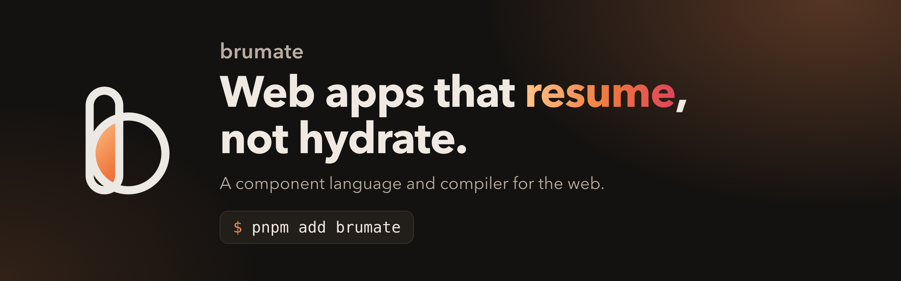

<p align="center"></p>

# brumate

> A component language and compiler for resumable web apps.

`brumate` compiles single-file components into server-rendered HTML and small client chunks. The client does not hydrate. It reads the state that the server wrote into the page and loads the code for an event handler only when that event fires.

The compiler generates a server module that renders HTML with the state, and client modules that resume it. A Vite plugin compiles `.brm` files in an app.

This repository holds the compiler and its runtime, the type checker and editor support, the website, examples, benchmarks and smoke tests. brumate is at 0.x: the page format can change between versions, so the server and the client must come from the same version.

## Goals

- Ship only the client code that an interaction can reach. Markup that never changes ships as HTML and nothing else.
- Never run component code again on the client to rebuild state.
- Keep the loader, the only code that loads before the page is used, under 1 KB. It is about 2 KB after gzip today.
- Keep the syntax small: scripts, markup with `#` blocks, and a few compile-time functions.

## Example

```html
<script>
  import { $memo, $props, $signal } from 'brumate/signals';
  import { prevent } from 'brumate/events';
  import { persist } from './todos.server';

  const { initial } = $props<{ initial: Todo[] }>();
  let todos = $signal(initial);
  let draft = $signal('');
  const left = $memo(todos.filter((todo) => !todo.done).length);

  async function add() {
    todos = [...todos, { id: crypto.randomUUID(), title: draft, done: false }];
    draft = '';
    await persist(todos);
  }
</script>

<h1>Todos</h1>
<form onSubmit=(prevent(add))>
  <input value=draft onInput=((event) => (draft = event.currentTarget.value))>
</form>
<ul>
  #for (todo of todos by todo.id) {
    <li class={ done: todo.done }>{todo.title}</li>
  }
</ul>
<p>{left} left</p>
```

The `<h1>` produces no client code. The `#for` item template ships because `add` can change `todos`. `persist` is a server function, so the client only gets a call stub.

## Try it

```bash
pnpm install
pnpm build
pnpm --filter example-todos dev
```

[`examples/todos`](./examples/todos) renders a todo list and a counter on the server. In the browser, only the loader runs until the page loads.

[`examples/tracker`](./examples/tracker) is a small issue tracker with sign-in, middleware, form validation, optimistic updates, streaming and a prerendered page. Run it with `pnpm --filter example-tracker dev`.

[`examples/hackernews`](./examples/hackernews) is a Hacker News reader with feeds, threads of comments and users, cached on the server. Run it with `pnpm --filter example-hackernews dev`.

[`examples/ui-kit`](./examples/ui-kit) is a package of components, and [`examples/kit-app`](./examples/kit-app) is an app that uses it.

## Documents

The documentation is in [`website/docs`](./website/docs), and the website shows it with samples that run in the page.

- [Introduction](./website/docs/index.md) and [Getting started](./website/docs/getting-started.md) set up a project.
- [Your first app](./website/docs/tutorial.md) builds a todo app step by step.
- The guides cover [components](./website/docs/components.md), [state](./website/docs/state.md), [async data](./website/docs/async-data.md), [server functions](./website/docs/server-functions.md), [routing](./website/docs/routing.md), [testing](./website/docs/testing.md), [publishing components](./website/docs/packages.md) and the rest.
- The reference lists every [compile-time function](./website/docs/reference-signals.md), [block](./website/docs/reference-blocks.md), [runtime export](./website/docs/reference-server.md) and [plugin option](./website/docs/reference-plugin.md).
- The internals describe the [reactive graph](./website/docs/reactive-graph.md), the [page format](./website/docs/page-format.md) and the [server function protocol](./website/docs/server-protocol.md).

Design notes for contributors are in [`docs`](./docs):

- [Grammar](./docs/grammar.md) defines the file format in EBNF.
- [Intermediate representation](./docs/ir.md) defines the data that each compiler stage produces.
- [Compiler](./docs/compiler.md) describes the pipeline, the output and the runtime.
- [Decisions](./docs/decisions.md) lists what is decided and what is still open.
- [Proposals](./docs/proposals.md) lists features that would be good to add, with a sketch of each.
- [Prior art](./docs/prior-art.md) compares other resumable and partially hydrated frameworks.

## Development

```bash
pnpm install
pnpm build
pnpm test
pnpm typecheck
pnpm lint
pnpm format
```

Build first: the examples and the website use the built `brumate` package.

The tests in [`packages/brumate/test/fixtures`](./packages/brumate/test/fixtures) parse and analyze each `.brm` file. The output of every stage is compared with a snapshot in `test/__snapshots__`. The tests in [`packages/brumate/test/render`](./packages/brumate/test/render) compile each component, render it on the server, and compare the modules, the HTML and the state with a snapshot. The tests in `test/resume.test.ts` load that HTML into a DOM, start the loader, and check that events update the page.

## Benchmarks

[`benchmarks`](./benchmarks) builds the same two pages with brumate, Qwik 1, Qwik 2 and Marko 6: a small counter and todo app, and a dashboard with 50 rarely used widgets. It compares the client code each page loads, the size of the server-rendered HTML, and how fast the server renders. It needs a local Chrome for the browser metrics.

```bash
pnpm bench
```

### Results

A run of `pnpm bench` on `main` at `38cecc9`, on 2026-10-22. The machine was an Apple M2 with 8 GB and Node 26.4.0. It was busy at the start (load average 4.15 on 8 cores), so the timings may be noisy. Sizes are raw / gzip -9. The renders per second are the median of 5 rounds.

Todos:

| Metric                                             |          brumate |         Marko 6 |            Qwik 1 |            Qwik 2 |
| -------------------------------------------------- | ---------------: | --------------: | ----------------: | ----------------: |
| JS before `load`                                   |  4.7 kB / 2.1 kB | 9.1 kB / 4.4 kB | 53.4 kB / 22.4 kB | 97.2 kB / 36.4 kB |
| Total JS after counter, toggle and add             | 17.1 kB / 7.7 kB | 9.1 kB / 4.4 kB | 54.4 kB / 22.8 kB | 99.6 kB / 38.2 kB |
| SSR HTML, 3 todos                                  |   1.3 kB / 653 B |  1.2 kB / 692 B |   2.9 kB / 1.3 kB |   3.6 kB / 1.5 kB |
| SSR renders/s, 3 todos                             |          111,874 |         131,896 |            15,778 |            12,372 |
| SSR renders/s, 100 todos                           |           10,334 |           8,195 |             2,394 |             2,333 |
| First counter click right after `load`, 150 ms RTT |           243 ms |           55 ms |            247 ms |            496 ms |

Dashboard:

| Metric                                     |           brumate |           Marko 6 |             Qwik 1 |              Qwik 2 |
| ------------------------------------------ | ----------------: | ----------------: | -----------------: | ------------------: |
| JS before `load`                           |   7.7 kB / 3.1 kB | 66.7 kB / 10.5 kB |  51.6 kB / 21.8 kB |   97.1 kB / 36.4 kB |
| JS fetched while idle 3 s                  |  18.5 kB / 8.7 kB |               0 B | 122.5 kB / 55.8 kB |  102.2 kB / 67.4 kB |
| Total JS after 3 widgets                   | 36.4 kB / 17.1 kB | 66.7 kB / 10.5 kB | 174.0 kB / 77.5 kB | 199.3 kB / 103.8 kB |
| Total JS after 3 widgets, idle preload off | 22.9 kB / 10.1 kB |               n/a |  58.6 kB / 25.0 kB |   97.1 kB / 37.2 kB |
| SSR HTML                                   |  34.5 kB / 6.7 kB |  27.5 kB / 5.4 kB |  51.4 kB / 13.0 kB |   66.0 kB / 16.1 kB |
| SSR renders/s                              |             3,893 |             6,155 |                837 |                 428 |
| First click right after `load`, 150 ms RTT |            289 ms |             85 ms |           1,638 ms |            1,659 ms |

[`benchmarks/README.md`](./benchmarks/README.md) describes each metric. A run writes the full tables to `benchmarks/results`.

## Smoke tests

[`e2e`](./e2e/README.md) builds the website and the examples, serves them, and uses them in Chrome. Run it with `pnpm e2e`.

## Name

Brumation is the dormant state of reptiles in cold weather. A reptile in brumation stays inactive but wakes up briefly to drink when it needs to, then goes back to rest. A `brumate` page does the same with its code. It loads a handler only when an event needs it.

## License

MIT © [lxsmnsyc](https://github.com/lxsmnsyc)
