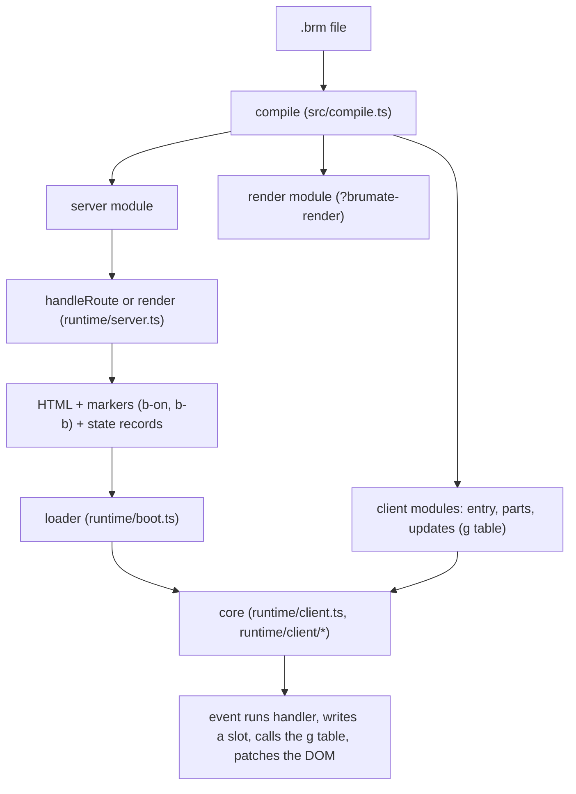

# Architecture and repo guide

This guide is for people and agents who work on brumate itself. It says how brumate works, where each part lives, and how to make a first change. The pages for users are in [`website/docs`](../website/docs). This page and the ones under [`docs/architecture`](./architecture) are internal.

Pages of this guide:

- This page: what brumate is, the repo map, a request from source to first click, the editor tooling, and how to work.
- [The brumate package](./architecture/brumate-package.md): the files in `packages/brumate/src`, one table per area.
- [Where to start](./architecture/where-to-start.md): the files and tests to touch for the common changes.

Design records that this guide links and does not repeat:

| Document                                       | Holds                                                                           |
| ---------------------------------------------- | ------------------------------------------------------------------------------- |
| [compiler.md](./compiler.md)                   | The pipeline, the three outputs, the runtime and its size.                      |
| [ir.md](./ir.md)                               | The four stages of the compiler and their data.                                 |
| [grammar.md](./grammar.md)                     | The grammar of a `.brm` file.                                                   |
| [performance.md](./performance.md)             | Measured costs, baselines and ideas not done yet.                               |
| [decisions.md](./decisions.md)                 | What is decided. Read it before you propose a syntax change.                    |
| [proposals.md](./proposals.md)                 | Features that are not decided, with a sketch of each.                           |
| [prior-art.md](./prior-art.md)                 | How other resumable frameworks differ.                                          |
| [roadmaps/brumate](./roadmaps/brumate/GOAL.md) | The plan, as nodes. See [Roadmap, PRs and releases](#roadmap-prs-and-releases). |

## What brumate is

brumate is a component language and a compiler for web apps that resume in the browser.

- A component is a `.brm` file with scripts, an optional `<style>` and markup. The server renders it.
- The browser does not hydrate. It reads the state that the server wrote into the page, and it runs no component function.
- The compiler builds the reactive graph once, at compile time. It writes the graph as tables of update functions. The client runtime calls them when a value changes. The runtime records no subscriptions.
- The compiler decides what the browser needs. Markup that nothing changes ships no code.
- The loader starts when the page loads. It imports the core and the bundles of the components in the page state at once. The code for a click is usually there before the click. An earlier event waits for the code and then runs.
- Navigation loads the next page as HTML with `fetch` and streams it in. Layouts that stay the same keep their state.

For a worked example of one component from source to click, read [Reactive graph](../website/docs/reactive-graph.md) and [What runs where](../website/docs/what-runs-where.md). For the decisions behind this, read [decisions.md](./decisions.md).

## Repo map

The repo is a pnpm workspace. [`pnpm-workspace.yaml`](../pnpm-workspace.yaml) lists `packages/*`, `examples/*`, `website`, `e2e` and `benchmarks/*`.

### Packages

| Path                                                          | What it is                                                                                                            | Used by                                 | Build and test                                                |
| ------------------------------------------------------------- | --------------------------------------------------------------------------------------------------------------------- | --------------------------------------- | ------------------------------------------------------------- |
| [`packages/brumate`](../packages/brumate)                     | The compiler, the Vite plugin, the server runtime, the client runtime, the CLI, the devtools. Published as `brumate`. | Every app, and every other package.     | `tsdown` builds `dist`. `vitest run`, in `test/`.             |
| [`packages/ui`](../packages/ui)                               | `@brumate/ui`: unstyled, accessible components written in `.brm`. Ships its source.                                   | Apps, the website, `examples/ui`.       | `brumate-tsc --noEmit` and `vitest run`, in `test/`.          |
| [`packages/language-core`](../packages/language-core)         | A Volar language plugin. It maps a `.brm` file to TypeScript with `toTypeScript` from `brumate`.                      | The three tools below.                  | `tsdown`. No tests of its own.                                |
| [`packages/language-server`](../packages/language-server)     | The language server. It gives styles and the diagnostics of the compiler.                                             | `packages/vscode`.                      | `tsdown`, `vitest run`.                                       |
| [`packages/typescript-plugin`](../packages/typescript-plugin) | A TypeScript server plugin. It gives `.brm` files types, completion and navigation.                                   | Editors that use the TypeScript server. | `tsdown`. No tests of its own.                                |
| [`packages/tsc`](../packages/tsc)                             | `brumate-tsc`: `tsc` that also checks `.brm` files.                                                                   | `brumate check`, CI, `packages/ui`.     | `tsdown`, `vitest run`.                                       |
| [`packages/vscode`](../packages/vscode)                       | The VS Code extension: grammar, language client and a bundled server.                                                 | VS Code users.                          | `tsdown` and `vsce package`. `vitest run` checks the grammar. |

The content mapper package is not on `main`. Pull request #3 holds it, and the roadmap node `content-mapper` tracks it.

### Other folders

| Path                                        | What it is                                                                                                          | How it is built and tested                                                        |
| ------------------------------------------- | ------------------------------------------------------------------------------------------------------------------- | --------------------------------------------------------------------------------- |
| [`website`](../website)                     | The docs site, written in brumate. `website/docs` and `website/ui` are user pages. `website/src` is the app.        | `pnpm --filter website build`, `check:samples`, `test`. Deploys on Vercel.        |
| [`examples`](../examples)                   | Apps that use brumate: `todos`, `tracker`, `hackernews`, `kit-app`, `nitro`, `ui`, `ui-kit`.                        | Each has `dev` and `build`. Most have `vitest run` in `test/`. `e2e` builds them. |
| [`benchmarks`](../benchmarks)               | The same three pages in brumate, Marko 6, Qwik 1 and Qwik 2. `benchmarks/harness` builds, serves and measures them. | `pnpm bench`. It needs Chrome and takes minutes, so run it alone.                 |
| [`e2e`](../e2e)                             | Smoke tests in Chrome of the website and the examples. See [`e2e/README.md`](../e2e/README.md).                     | `pnpm e2e`. About 10 minutes.                                                     |
| [`docs`](.)                                 | This folder: internal design notes.                                                                                 | Prose only. A change here skips CI.                                               |
| [`docs/roadmaps`](./roadmaps)               | The plan. [`docs/roadmaps/brumate`](./roadmaps/brumate) has `GOAL.md`, `nodes/`, `contracts/` and `reviews/`.       | Read by the `parallel-roadmap` skill's `plan.py`.                                 |
| [`docs/debates`](./debates)                 | Records of goal debates: `loading-on-update` and `pending-handler-reads`.                                           | Prose only.                                                                       |
| [`.changeset`](../.changeset)               | One file for each change that a user can see. `config.json` sets the release rules.                                 | `pnpm changeset`. See the changesets skill for the bump level.                    |
| [`.github/workflows`](../.github/workflows) | `test.yml` checks each push and pull request. `release.yml` opens the version pull request and publishes.           | See [CI](#ci).                                                                    |
| [`.claude/skills`](../.claude/skills)       | Links to the skills that ship in the packages, such as `brumate` for writing `.brm` files.                          | Checked by `packages/brumate/test/skill.test.ts`.                                 |

## A request from source to first click

This is the path for one page. Each step names the file where it happens. [The brumate package](./architecture/brumate-package.md) has the tables.

1. **Compile.** `compile()` in [`compile.ts`](../packages/brumate/src/compile.ts) runs the pipeline for one file. The Vite plugin in [`vite.ts`](../packages/brumate/src/vite.ts) calls it from `transform` and serves the three outputs under the queries `?brumate-client`, `?brumate-render` and `?brumate-server`. The stages are parse, analyze, graph, plan and codegen. See [compiler.md](./compiler.md) and [ir.md](./ir.md).
2. **Route.** `handleRoute` in [`runtime/server.ts`](../packages/brumate/src/runtime/server.ts) matches the URL to a route file under `src/routes` through `virtual:brumate/routes`. Layouts render before their children. Middleware, server function calls and form posts go through `handleRequest` and the same module.
3. **Render.** The server module of the component runs on the server only. It writes HTML, and it marks the elements and positions that the client must find: `b-on` for handlers, `b-b` for elements with a slot, and comments for blocks and inserts.
4. **State records.** `packState` and `stateScript` in the same file write the values of the scopes that client code reaches. Each record is an inline script that calls `$brm` with a function of the values. The records stream after the first chunk, so a `#loading` body or a memo that waits does not hold up the page.
5. **Response.** `renderToStream` sends the document. The `<script>` of the client entry from `src/client.ts` imports `virtual:brumate/start`, which calls `start()` from `brumate/loader`.
6. **Loader.** [`runtime/boot.ts`](../packages/brumate/src/runtime/boot.ts) listens on `document` for the events in `b-on`. It applies event wrappers such as `prevent` at once. It imports the core and the bundles of the components in the state records, and it holds an event until the code is there.
7. **Resume.** [`runtime/client/resume.ts`](../packages/brumate/src/runtime/client/resume.ts) reads the records into scopes. It indexes the markers. It loads the modules of the components that have a scope on the page.
8. **First click.** `handle` in [`runtime/client/handlers.ts`](../packages/brumate/src/runtime/client/handlers.ts) finds the scope of the nearest element with `b-b`, and runs the handler of the client module. A write to a slot calls the functions that the `g` table lists for it, in [`runtime/client/updates.ts`](../packages/brumate/src/runtime/client/updates.ts). Those functions set text, attributes, blocks and lists. Memos and effects run in an order that the compiler fixed.
9. **Server calls.** A handler that calls a server function sends a `fetch` to `/_brumate/<id>`. [`runtime/rpc.ts`](../packages/brumate/src/runtime/rpc.ts) writes the call, and `handleRequest` answers it. The code for this loads on the first call, with seroval.
10. **Navigation.** A link click loads [`runtime/navigate.ts`](../packages/brumate/src/runtime/navigate.ts). It fetches the next page as HTML and records, and replaces only the routes that changed.

## Editor tooling

The chain, from the compiler to the editor:

1. `toTypeScript` in [`check.ts`](../packages/brumate/src/check.ts) turns a `.brm` file into TypeScript with mappings back to the file.
2. [`@brumate/language-core`](../packages/language-core/src/index.ts) wraps it as a Volar language plugin. It reports a syntax error through a callback.
3. [`@brumate/typescript-plugin`](../packages/typescript-plugin/src/index.ts) loads that plugin into the TypeScript server. It drops repeated diagnostics of a template used twice.
4. [`@brumate/language-server`](../packages/language-server/src/index.ts) runs the same plugin with the CSS service and the diagnostics of the compiler (`diagnostics.ts`).
5. [`brumate-tsc`](../packages/tsc/src/index.ts) runs `tsc` through Volar's `runTsc` with the plugin. TypeScript 7 has no programmatic API, so it uses the TypeScript 6 compiler, installed as `typescript-api`. It prints syntax errors of `.brm` files and fails the run.
6. [`packages/vscode`](../packages/vscode) bundles the language server, the grammar in `syntaxes/` and the extension in `src/extension.ts`.

`brumate check` ([`check-command.ts`](../packages/brumate/src/check-command.ts)) compiles every file and then runs `brumate-tsc`. A change to the shape of the TypeScript output in `check.ts` needs a rebuild of `brumate` before the other packages see it, since they import `dist`.

## How to work here

### Commands

Run these from the repo root. Node 22 or later and pnpm 12 are needed.

| Command                               | Does                                                                                                                            |
| ------------------------------------- | ------------------------------------------------------------------------------------------------------------------------------- |
| `pnpm install`                        | Installs the workspace.                                                                                                         |
| `pnpm build`                          | Builds `packages/*`. Build first: the examples and the website use the built `brumate`.                                         |
| `pnpm test`                           | Runs the tests of `packages/*` and `examples/*`.                                                                                |
| `pnpm --filter <name> test`           | Runs one project, such as `pnpm --filter brumate test` or `--filter @brumate/ui`. Add a file name after `test` to run one file. |
| `pnpm lint`, `pnpm lint:fix`          | Runs `oxlint`.                                                                                                                  |
| `pnpm format`, `pnpm format:check`    | Runs `oxfmt`. CI runs `format:check` on the whole repo.                                                                         |
| `pnpm typecheck`                      | Runs the `typecheck` script of every project.                                                                                   |
| `pnpm e2e`                            | Builds and checks the website and the examples in Chrome. Options are in [`e2e/README.md`](../e2e/README.md).                   |
| `pnpm bench`                          | Runs the framework comparison. See [`benchmarks/README.md`](../benchmarks/README.md).                                           |
| `pnpm --filter website check:samples` | Compiles every live sample of the docs and fails on a warning.                                                                  |
| `pnpm changeset`                      | Writes a changeset.                                                                                                             |

Run `oxlint`, the root `oxfmt --check` and `pnpm typecheck` before a push. A fast check that is safe in parallel worktrees is `pnpm lint && pnpm format:check && pnpm typecheck`, then the tests of the code you changed.

### CI

[`test.yml`](../.github/workflows/test.yml) runs on pushes to `main` and on pull requests, and ignores `docs/**`. It skips draft pull requests. Each run uses Node 22 and Node 24 and runs, in order: `pnpm build`, `lint`, `format:check`, `typecheck`, `test`, `website check:samples`, `website test` and `website build`. `e2e` and `bench` do not run in CI. Run `pnpm e2e` before a release and after large merges.

[`release.yml`](../.github/workflows/release.yml) runs on `main`. It opens a version pull request from the changesets, or builds, tests and publishes to npm when that pull request merges. The publish job uses the `npm` environment.

### Tests

| Area                 | Where                                                                                | Notes                                                                               |
| -------------------- | ------------------------------------------------------------------------------------ | ----------------------------------------------------------------------------------- |
| Parser and model     | `packages/brumate/test/fixtures/*.brm`, `fixtures.test.ts`, `__snapshots__`          | Each stage output is a snapshot.                                                    |
| Codegen and render   | `packages/brumate/test/render/*.brm`, `render.test.ts`, `codegen.test.ts`            | Compares the modules, the HTML and the state with a snapshot.                       |
| Resume               | `packages/brumate/test/resume.test.ts`, `testing/`                                   | Loads the HTML into happy-dom, starts the loader and fires events.                  |
| Compile errors       | `parser.test.ts`, `diagnostics.test.ts`, `check-command.test.ts`, `error-codes.json` | The last two pin each error code to its message.                                    |
| Vite plugin          | `vite.test.ts`, `vite-app/`                                                          | Builds small apps.                                                                  |
| `@brumate/ui`        | `packages/ui/test`, about 78 files                                                   | Each part renders on the server and resumes in happy-dom through `brumate/testing`. |
| Website and examples | `website/test`, `examples/*/test`                                                    | Plugins of the site, and the apps.                                                  |
| Browser              | `e2e/suites`                                                                         | Real Chrome.                                                                        |

Known slow or load-sensitive suites:

- `packages/ui/test/client-part-imports.test.ts` compiles every part and has a 30 second timeout.
- The `packages/ui` suite is large and gets flaky when many test runs share a machine. The roadmap runs at most 3 workers at once for this reason.
- Do not loop a suite to chase a rare failure. Run it on the base branch a few times, note the result in the pull request, and move on.
- `pnpm bench` must run alone, since other load changes the timings.

The vitest configs of `packages/ui` and the `brumate` tests alias `brumate/*` to the source files, so those tests do not need a build. The examples, the website and the editor packages use `dist`, so run `pnpm build` after you change `packages/brumate`.

### Roadmap, PRs and releases

- **Roadmap.** [`docs/roadmaps/brumate/GOAL.md`](./roadmaps/brumate/GOAL.md) holds the outcome, the priorities, the milestones, the constraints and the coverage of the proposals. The milestones are releases: 0.4.0, 0.5.0, 0.6.0 and backlog. Each node is a folder under `nodes/` with a brief, a log and an outcome. A node's status is the `status` field of its brief. [`CLAUDE.md`](./roadmaps/brumate/CLAUDE.md) in that folder has the rules for a worker: edit only your owned paths, do not edit other briefs or contracts, and write `outcome.md` when done. `contracts/` holds interfaces that nodes agree on. `reviews/` holds checklists and past review rounds. [`docs/roadmaps/README.md`](./roadmaps/README.md) has the commands.
- **Pull requests.** One concern for each pull request, small, and mergeable alone. Work opens a draft. The draft becomes ready after a clean review and passing local checks. The frontmatter of `GOAL.md` sets the review mode and the merge policy. In mode `auto`, a node of size S, docs or chore reviews itself. The rest get a fresh reviewer.
- **Fixes of a bug on `main`.** Branch from `main` and open a separate pull request. Do not stack it on a feature.
- **Changesets.** A change that users can see needs a file in `.changeset/`. The package is at 0.x, so a breaking change is a minor bump, and nothing has a deprecation period. Docs and chore changes need none.
- **Writing.** Commit messages, pull request text, docs and comments follow the plain-writing skill: short sentences, facts, no metaphors, no em-dashes. Code follows the ts-style skill: `for...of` loops, function declarations, comments on steps.
- **Release.** The nodes `changeset-review` and `release-0.4` own the 0.4.0 cut. The release workflow does the publish.
